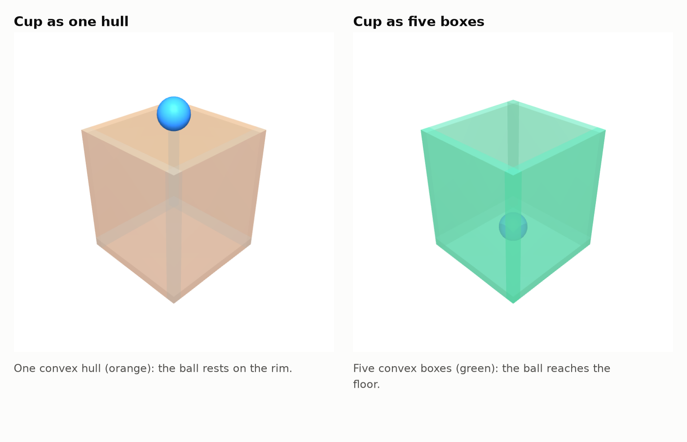
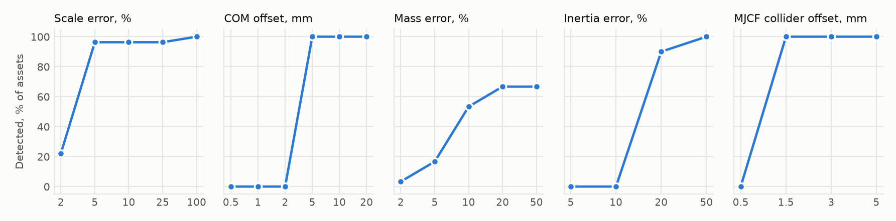

# simready-audit

A checker for sim-ready 3D assets. It reads an asset's OpenUSD physics and its MuJoCo (MJCF) export, checks that the two agree, checks the geometry and the physics numbers against each other, and then runs short MuJoCo experiments to see whether the asset behaves the way its USD says it should.

It was built and tested on the public [projectsim](https://projectsim.ai) datasets by Kaedim ([Bottles & Containers](https://huggingface.co/datasets/projectsim/bottles-and-containers), CC BY 4.0). The checker also tests itself: every check is exercised with planted defects and with harmless transformations, and the results are reported below.

## What it checks

| ID | Check | Fails or warns when |
|---|---|---|
| A1 | Stage units and up axis | stage units are not metres / kilograms / Z-up |
| A2 | Physics schema present and valid | no rigid body, no mass and no density, no collider, unbound physics material, invalid friction or restitution |
| A3 | MJCF compiles in MuJoCo | the MJCF does not compile |
| A4 | Mass parity USD vs MJCF | USD and MJCF mass differ by more than 1e-5 (relative) |
| A5 | Centre-of-mass parity USD vs MJCF | USD and MJCF centre of mass differ by more than 1 µm |
| A6 | Inertia tensor parity USD vs MJCF | USD and MJCF inertia tensors differ by more than 1e-4 (relative Frobenius) |
| A7 | MJCF friction within USD static/dynamic interval | MJCF sliding friction lies outside the USD [dynamic, static] interval |
| A8 | Restitution carried into MJCF contact | USD restitution > 0.05 but the MJCF contact is critically damped (warn) |
| A9 | Collider approximation intent vs MJCF geoms | information: USD collider approximation vs number of MJCF mesh geoms |
| A10 | max_mass_kg matches documented meaning (cavity x water) | max_mass_kg equals the physics mass, exceeds the convex envelope, or is >25% off the expected capacity |
| B1 | Collider is closed and 2-manifold | collider has boundary or non-manifold edges |
| B2 | Collider winding consistent and outward | inconsistent or inward winding |
| B3 | No degenerate collider faces | faces smaller than 1e-12 m² (warn) |
| B4 | Collider components | information: connected components |
| B5 | MuJoCo effective collider has no phantom surface | over 2% of the MuJoCo collision surface lies more than 2 mm from the authored collider (warn) |
| B6 | MJCF collision geometry sits on the USD collider | MJCF collision vertices sit more than 1 mm off the USD collider (warn) |
| C1 | Dimensions match the dataset card | dimensions outside the dataset card's stated formats (warn) |
| C2 | Mass equals density x collider volume | mass differs from density × volume by >5% (warn) or >20% (fail); thin-walled classes reported only |
| C3 | Mass plausible against cited real-world values | implied wall thinner than the thinnest commercial can wall, 0.097 mm (warn) |
| C4 | Inertia is physically valid | inertia not positive definite or violates the triangle inequality |
| C5 | Inertia consistent with the mass distribution | inertia per unit mass outside the band any solid-to-shell mass distribution in this shape allows (thin-walled classes must be shell-like) |
| C6 | Centre of mass consistent with geometry | COM outside the bounding box (fail) or >2% of the diagonal away from the solid/shell centroids (warn) |
| D1 | Drop test: stable, no energy gain, no sinking | drop from 14 orientations: NaN, energy gain >1%, penetration >0.5 mm (fail); upright drop that never settles (warn) |
| D2 | Timestep sensitivity (0.5/1/2 ms) | instability at 0.5 / 1 / 2 ms (fail); penetration or upright outcome changes (warn) |
| D3 | Slide angle matches authored friction | critical slide angle outside atan(μd)…atan(μs) of the USD material by more than 2° |
| D4 | Can rolling acceleration | information: rolling acceleration of cans vs the value their inertia implies |
| D5 | Cavity probe: a ball dropped into the cup enters it | a ball dropped into an open container stays on top of it |

Thresholds live in [`configs/thresholds.v1.yaml`](configs/thresholds.v1.yaml). Their SHA-256 is frozen in `configs/FROZEN.sha256`, and an official run refuses to start if the config has changed (`--allow-unfrozen` is for exploration only). Every result file is stamped with the config hash, the dataset revision, the `uv.lock` hash, the git commit and the library versions.

## Results on Bottles & Containers

Revision `2d5aa958dd92`, 149 assets, config `f41e25c75093`, 27.9 s on a laptop (8 workers).

| Check | Cans (34) | Jars (40) | Mugs (75) |
|---|---|---|---|
| A1 Stage units and up axis | 34 / 0 / 0 | 40 / 0 / 0 | 75 / 0 / 0 |
| A2 Physics schema present and valid | 34 / 0 / 0 | 40 / 0 / 0 | 75 / 0 / 0 |
| A3 MJCF compiles in MuJoCo | 34 / 0 / 0 | 40 / 0 / 0 | 75 / 0 / 0 |
| A4 Mass parity USD vs MJCF | 34 / 0 / 0 | 40 / 0 / 0 | 75 / 0 / 0 |
| A5 Centre-of-mass parity USD vs MJCF | 34 / 0 / 0 | 40 / 0 / 0 | 75 / 0 / 0 |
| A6 Inertia tensor parity USD vs MJCF | 34 / 0 / 0 | 40 / 0 / 0 | 75 / 0 / 0 |
| A7 MJCF friction within USD static/dynamic interval | 34 / 0 / 0 | 40 / 0 / 0 | 0 / 0 / 75 |
| A8 Restitution carried into MJCF contact | 0 / 34 / 0 | 0 / 40 / 0 | 75 / 0 / 0 |
| A9 Collider approximation intent vs MJCF geoms | – | – | – |
| A10 max_mass_kg matches documented meaning (cavity x water) | 0 / 0 / 34 | 0 / 0 / 40 | 0 / 0 / 75 |
| B1 Collider is closed and 2-manifold | 34 / 0 / 0 | 40 / 0 / 0 | 75 / 0 / 0 |
| B2 Collider winding consistent and outward | 34 / 0 / 0 | 40 / 0 / 0 | 75 / 0 / 0 |
| B3 No degenerate collider faces | 32 / 2 / 0 | 39 / 1 / 0 | 75 / 0 / 0 |
| B4 Collider components | – | – | – |
| B5 MuJoCo effective collider has no phantom surface | 0 / 34 / 0 | 2 / 38 / 0 | 0 / 75 / 0 |
| B6 MJCF collision geometry sits on the USD collider | 34 / 0 / 0 | 40 / 0 / 0 | 75 / 0 / 0 |
| C1 Dimensions match the dataset card | 20 / 3 / 0 | 30 / 10 / 0 | 48 / 27 / 0 |
| C2 Mass equals density x collider volume | – | 40 / 0 / 0 | 63 / 12 / 0 |
| C3 Mass plausible against cited real-world values | 0 / 34 / 0 | – | – |
| C4 Inertia is physically valid | 34 / 0 / 0 | 40 / 0 / 0 | 75 / 0 / 0 |
| C5 Inertia consistent with the mass distribution | 0 / 0 / 34 | 40 / 0 / 0 | 75 / 0 / 0 |
| C6 Centre of mass consistent with geometry | 34 / 0 / 0 | 40 / 0 / 0 | 62 / 13 / 0 |
| D1 Drop test: stable, no energy gain, no sinking | 33 / 1 / 0 | 40 / 0 / 0 | 75 / 0 / 0 |
| D2 Timestep sensitivity (0.5/1/2 ms) | 34 / 0 / 0 | 40 / 0 / 0 | 73 / 2 / 0 |
| D3 Slide angle matches authored friction | 34 / 0 / 0 | 40 / 0 / 0 | 0 / 0 / 75 |
| D4 Can rolling acceleration | – | – | – |
| D5 Cavity probe: a ball dropped into the cup enters it | – | – | 0 / 0 / 75 |

Cells read `pass / warn / fail`; `info` and `skip` rows are shown as `–`. A detailed write-up of what the warnings and failures mean for these assets is shared with Kaedim directly rather than published here.

## How do I know the checker is right?

**Analytic fixtures.** `pytest` runs 33 tests. Volumes and inertias of boxes, prisms and cups match closed-form values to 1e-10. A dropped box rests with under 0.05 mm of penetration. A block's sliding angle matches atan(μ) within 0.3° for μ = 0.2, 0.5 and 0.8. Solid and hollow cylinders roll at the accelerations theory predicts, within 2%.

**A probe that can tell a cup from its convex hull.** The cavity probe drops a ball into a container. On a cup built from five boxes the ball reaches the floor; on the same cup's convex hull it stops at the rim:



**Mutation study.** 19 kinds of defects were planted into 30 real assets (10 per class), each rewritten at the file level the way a broken exporter would. A defect counts as caught only if the check aimed at it flips from pass to warn or fail on an asset where that check passed before, so problems already present in the data cannot inflate the score.

| Planted defect | Target check | Caught (assets where the check passed beforehand) |
|---|---|---|
| scale_x10 | C1, C2 | 27/27 |
| scale_x0.1 | C1, C2 | 27/27 |
| units_cm | A1 | 30/30 |
| up_axis_y | A1 | 30/30 |
| delete_1pct_faces | B1 | 30/30 |
| flip_10pct_faces | B2 | 30/30 |
| flip_all_faces | B2 | 30/30 |
| degenerate_faces | B3 | 30/30 |
| mass_x10_usd_only | A4, A6 | 30/30 |
| mass_x2_both | C2 | 20/30 |
| com_offset_both_10mm | C6 | 28/28 |
| com_offset_mjcf_1mm | A5 | 30/30 |
| inertia_x2_both | C5 | 20/20 |
| inertia_mjcf_only_x1.1 | A6 | 30/30 |
| friction_mjcf_0.9 | A7 | 20/20 |
| collider_offset_mjcf_5mm | B6 | 30/30 |
| max_mass_equals_mass | A10 | not scorable (target already fails on every asset; covered by a unit test) |
| restitution_1.5 | A2 | 30/30 |
| unbind_physics_material | A2 | 30/30 |

Smallest errors caught (share of assets flagged at each magnitude):



**False positives.** Four transformations that should change nothing were applied to the same 30 assets: rotating the asset 37° about Z, shuffling vertex and face order, moving the root, and re-saving the USD as binary. Across 2268 pass/warn/fail verdicts (information-only checks excluded), 0 changed.

**Determinism.** `simready-audit verify` runs the audit with 1 worker and with 8 and compares the canonical SHA-256 of the results. It also re-hashes every downloaded file against the pinned lock.

**Known blind spots** (also measured above): for classes that the dataset card calls thin-walled (cans), mass cannot be checked against volume, so a mass error on a can is not caught; scale errors under about 2% are inside the dimension tolerance.

## Quickstart

```bash
git clone https://github.com/Shailendra005/simready-audit && cd simready-audit
uv sync --frozen
make download        # pinned revisions, physics files only (~1.8 GB with MJCF textures)
make test audit      # ~1 minute
make fix mutate controls verify report
```

Single commands:

```bash
uv run simready-audit audit --static-only     # contract, geometry and physics checks only
uv run simready-audit fix                      # convex-decompose colliders, carry USD friction into MJCF
uv run simready-audit mutate                   # the self-test above
```

## What it cannot see

- No Isaac Sim / PhysX runs. USD physics is read as authored, not simulated; behavioural tests run in MuJoCo only.
- Real-world plausibility is checked only where a cited reference exists (aluminium can wall gauge).
- Thresholds were chosen after an exploratory look at the data, then frozen; they are physical tolerances, not tuned cut-offs, but they were not pre-registered.
- Articulated assets (drawers, doors) are not covered yet.
- The MJCF reader handles flat default classes; nested defaults and `childclass` inheritance are not resolved.
- The phantom-surface metric samples the surface; classification at the 2 mm threshold is exact, but the reported p95 is an upper bound.

## Layout

```
src/simready_audit/
  io/         USD and MJCF loaders (units, up-axis, xform stacks, principal axes)
  analytics/  mass properties, shells, manifold unions, convex hulls, surface distances
  checks/     A contract, B geometry, C physical plausibility
  sim/        MuJoCo drop, timestep, incline, roll and cavity tests
  fixes/      CoACD decomposition and MJCF rewriting
  mutate/     defect and invariance transformations, study runner
  report/     statistics, figures and the reports generated from results
tests/        analytic, loader, check and simulation fixtures
```

## Attribution

Asset data: Kaedim / projectsim, CC BY 4.0. Nothing from the datasets is redistributed here; `make download` fetches the pinned revisions. See [ATTRIBUTION.md](ATTRIBUTION.md).

Code: MIT.